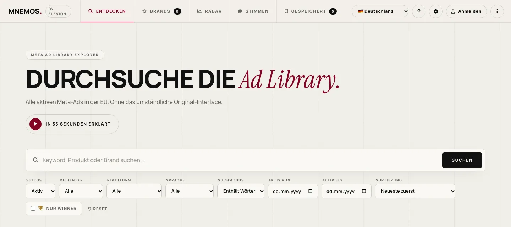

# Mnemos · Meta Ad Library Explorer

A faster, friendlier front end for the [Meta Ad Library](https://www.facebook.com/ads/library/). Search every active ad in the EU, track competitor brands, spot long-running winners and keep a swipe file. Live at **[elevion.studio/mnemos](https://elevion.studio/mnemos)**. Built with [Claude Code](https://claude.com/claude-code).



## Features

- **EU search** over all Meta ads (Facebook, Instagram, Messenger, Audience Network) via the official [Ad Library API](https://www.facebook.com/ads/library/api). Under the EU Digital Services Act the API returns every ad in EU/EEA countries, not only political ones.
- **Filters**: status, media type, platform, language, date range, exact phrase vs. keywords, "winners only".
- **Winner detection**: ads are scored by run time and reach and tagged by hook type (testimonial, listicle, offer, question hook, ...).
- **Brands & Radar**: save brands to a watchlist; a daily job tracks each brand's impression ranking and shows rank history, trend and sparklines.
- **Swipe file** with folders, plus one-click download of creatives.
- **Accounts & cloud sync** (optional, Supabase with Row Level Security). Without an account everything runs in guest mode on `localStorage`.
- **US, UK & worldwide** search through the [ScrapeCreators API](https://scrapecreators.com), since the official API only covers non-political ads inside the EU.
- **PWA**, demo mode without any token, German UI.

## Architecture

```
index.html, app.js, styles.css   Vanilla JS front end, no build step, no framework
supabase-config.js               Your Supabase URL + publishable key (empty = guest mode)
supabase-sync.js                 Auth + sync of brands, swipe file and folders
supabase/schema.sql              Tables and RLS policies
supabase/schema-cron.sql         Daily schedule for the Radar job
supabase/functions/track-brands  Edge function that records brand rankings
netlify/functions/meta.mjs       Optional shared Meta token, kept server side
netlify/functions/featured.mjs   Refreshes the "current winners" on the start page
netlify/functions/download.mjs   Download proxy for creatives (fbcdn only, not an open proxy)
scripts/build-featured.mjs       Builds featured.json locally
sw.js, manifest.json             Offline shell / installable app
```

All keys come from environment variables or from the user's own browser storage. Nothing secret is committed.

## Run it

1. Open `index.html` or deploy the folder as-is to Netlify (no build command).
2. EU search: either set `META_TOKEN` on Netlify (shared access through `/api/meta`) or paste your own token under ⚙️ Settings. Getting a token: confirm your identity at facebook.com/ID, accept the Ad Library API terms, create an app on developers.facebook.com and generate a token in the Graph API Explorer.
3. Worldwide search (optional): add a ScrapeCreators key in Settings, or set `SC_KEY` for the featured-winners function.
4. Accounts & Radar (optional): see [`SUPABASE_SETUP.md`](SUPABASE_SETUP.md) (German).

## Note on creatives

Meta does not expose ad images or videos through the API and blocks embedding the snapshot pages. Mnemos therefore shows copy, headline and a link to the original creative; the hosted version adds an optional companion browser extension for inline previews, which is not part of this repository.

## License

MIT. Not affiliated with Meta.
